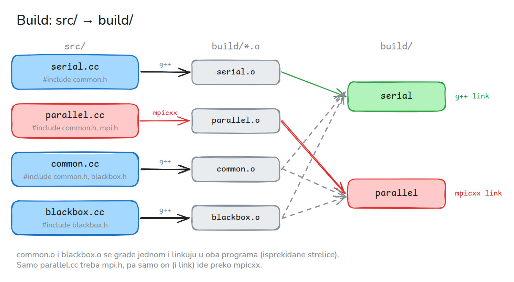
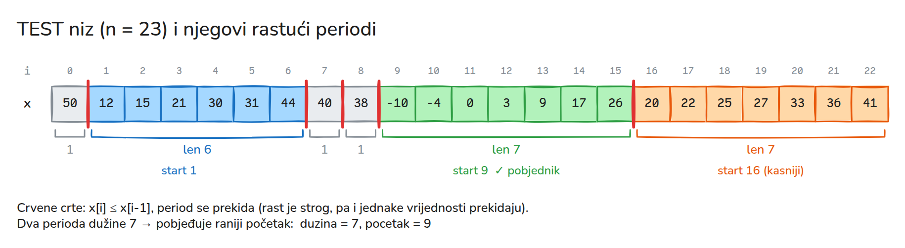
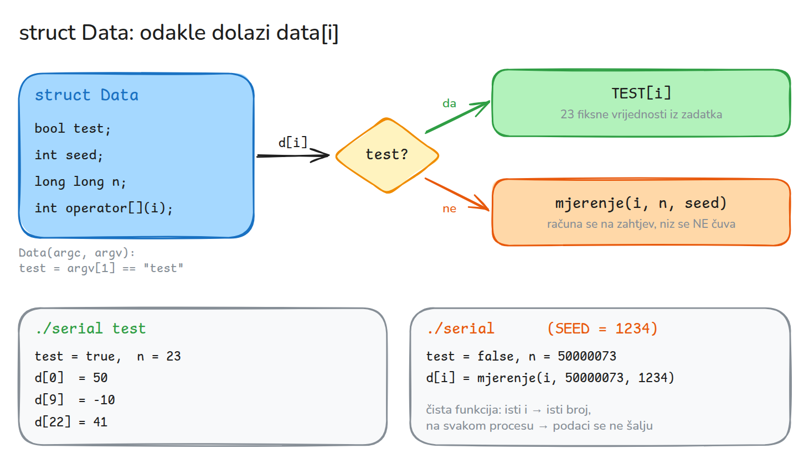
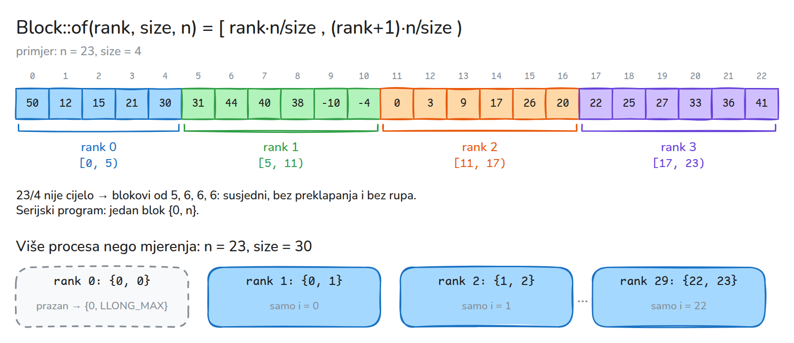
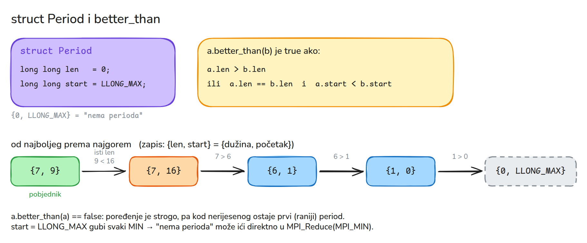
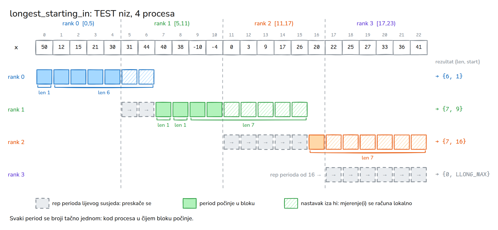
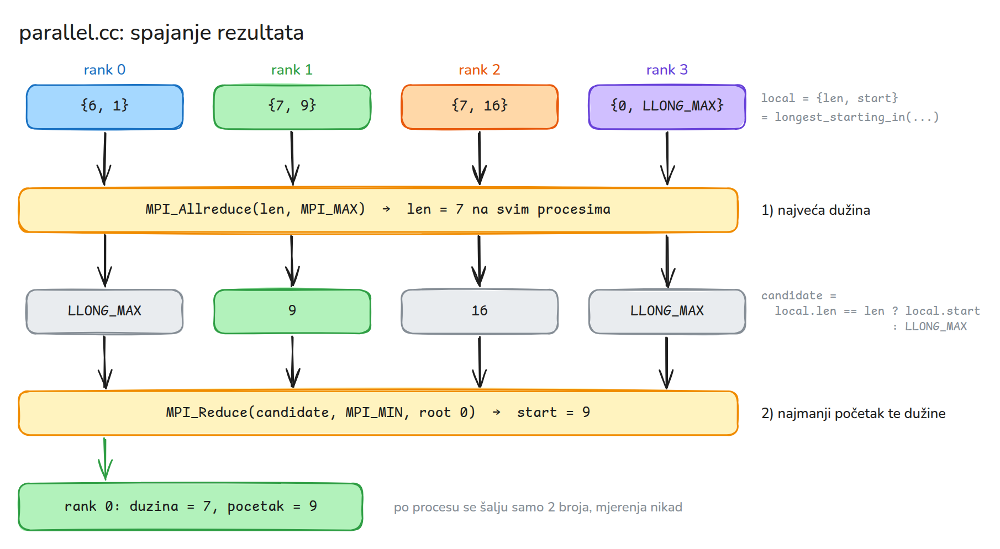

# Z1: najduži period rasta

Program traži najduži **strogo rastući** niz uzastopnih mjerenja temperature. Ispisuje njegovu **dužinu** i **početak**. Ako su dva perioda iste dužine, ispisuje se onaj s manjim početkom.

Postoje dva programa koji dijele isti kod:

- `serial`: jedan proces prolazi cijeli niz;
- `parallel`: MPI, pristup C. Period pripada procesu u čijem bloku počinje.

Ostali razmotreni pristupi su u [interaktivnom pregledu pristupa](https://claude.ai/artifact/DVmv4p5uZUjERPPoooXyyC), a plan rada je u [plan.md](plan.md).

## Brzi start

```bash
make              # gradi build/serial i build/parallel
make test         # TEST niz: serial i parallel za 1..8 procesa moraju dati 7 / 9
make compare      # prava mjerenja: parallel mora dati isto što i serial
make bench        # vremena: serial i parallel za p = 1, 2, 4, 8
make clean        # briše build/

make run-serial ARGS=test           # ./build/serial test
make run-parallel NP=8              # mpirun -n 8 ./build/parallel
```

Primjer izlaza:

```
$ ./build/serial test
duzina = 7, pocetak = 9
vrijeme = 3.93e-07 s

$ mpirun -n 4 ./build/parallel        # SEED = 1234
duzina = 45, pocetak = 25000013
vrijeme = 0.157704 s
```

> `SEED` u `inc/common.h` je još `1234`. Treba upisati zadnje 4 cifre broja indeksa.

## Struktura

```
z1/
├── inc/
│   ├── blackbox.h    deklaracije broj_mjerenja, mjerenje
│   └── common.h      SEED, Data, Block, Period, longest_starting_in, print_result
├── src/
│   ├── blackbox.cc   black box iz zadatka, kopiran bez izmjena
│   ├── common.cc     TEST niz i implementacije iz common.h
│   ├── serial.cc     main serijskog programa
│   └── parallel.cc   main MPI programa
├── docs/             dijagrami: *.excalidraw (izvor) i *.png (u README-u)
├── build/            .o, .d, serial, parallel (ignorisan u gitu)
├── Makefile
├── plan.md
└── approaches.html
```



- `serial.cc` i `parallel.cc` sadrže samo `main`. Sva logika je u `common.cc`, pa se ništa ne duplira.
- Samo `parallel.o` se kompajlira sa `mpicxx`; ostali objekti se kompajliraju sa `g++`.
- `common.o` i `blackbox.o` se grade jednom i linkuju u oba programa.

## Primjer niza

Svi primjeri ispod koriste `TEST` niz iz zadatka (n = 23):



Ovdje postoje dva perioda dužine 7, na početku 9 i na početku 16. Pobjeđuje raniji, pa je rezultat **7 / 9**.

---

## Black box (`blackbox.h`, `blackbox.cc`)

| Funkcija | Šta vraća |
|---|---|
| `long long broj_mjerenja(int seed)` | broj mjerenja n (oko 50 miliona) |
| `int mjerenje(long long i, long long n, int seed)` | i-to mjerenje u desetinkama stepena |

`mix` je `static inline`, pa se ne vidi izvan `blackbox.cc`. `mjerenje` je **čista funkcija**: za isti `(i, n, seed)` uvijek vraća isti broj. Zbog toga svaki proces može sam izračunati bilo koje mjerenje, pa podatke ne treba slati.

```cpp
long long n = broj_mjerenja(1234);   // 50000073
int x = mjerenje(0, n, 1234);        // isto na svakom procesu, svaki put
```

---

## Strukture podataka (`common.h`)

### `Data`: izvor mjerenja

```cpp
struct Data {
    bool test;       // true ako je prvi argument "test"
    int seed;        // SEED
    long long n;     // 23 za test, inače broj_mjerenja(seed)

    Data(int argc, char* argv[]);
    int operator[](long long i) const;   // TEST[i] ili mjerenje(i, n, seed)
};
```

Ostatak koda ne zna odakle dolaze brojevi. Samo piše `data[i]`.



```cpp
// ./serial test
Data d(argc, argv);   // test = true, n = 23
d[0];                 // 50
d[9];                 // -10
d[22];                // 41

// ./serial
Data d(argc, argv);   // test = false, n = 50000073 (seed 1234)
d[i];                 // == mjerenje(i, 50000073, 1234)
```

Niz se **ne čuva** u memoriji. `operator[]` računa vrijednost na zahtjev, pa program koristi O(1) memorije.

### `Block`: dio niza jednog procesa

```cpp
struct Block {
    long long lo, hi;    // poluotvoren interval [lo, hi)
    static Block of(int rank, int size, long long n);
};
```

`Block::of` vraća `[rank·n/size, (rank+1)·n/size)`. Zapis `{a, b}` za blok uvijek znači `{lo, hi}`: prvi indeks u bloku i prvi indeks **iza** bloka. Blokovi su susjedni, ne preklapaju se i zajedno pokrivaju cijeli niz, čak i kad n nije djeljiv sa size.



```cpp
// n = 23, 4 procesa
Block::of(0, 4, 23);   // {lo=0,  hi=5}   ->  0..4
Block::of(1, 4, 23);   // {lo=5,  hi=11}  ->  5..10
Block::of(2, 4, 23);   // {lo=11, hi=17}  -> 11..16
Block::of(3, 4, 23);   // {lo=17, hi=23}  -> 17..22

// više procesa nego mjerenja: neki blokovi su prazni
Block::of(0, 30, 23);  // {lo=0,  hi=0}   -> prazan
Block::of(1, 30, 23);  // {lo=0,  hi=1}   -> samo 0
```

`of` je `static`, dakle funkcija **tipa**, a ne objekta. Poziva se kao `Block::of(...)` i služi kao imenovani konstruktor. Serijski program ne treba `of`, nego blok pravi direktno: `{0, data.n}` (`lo = 0`, `hi = n`).

### `Period`: rastući period

```cpp
struct Period {
    long long len = 0;
    long long start = LLONG_MAX;    // {len=0, start=LLONG_MAX} = "nema perioda"
    bool better_than(const Period& other) const;
};
```

Zapis `{a, b}` za period uvijek znači `{len, start}`: **prvi član je dužina**, a **drugi indeks prvog mjerenja**. Npr. `{7, 9}` je period dužine 7 koji počinje na `i = 9` (`-10, -4, 0, 3, 9, 17, 26`).

`better_than` znači: duži je bolji, a kod iste dužine bolji je onaj s manjim početkom. Poređenje je strogo, pa jednak period nije "bolji".



```cpp
Period a{7, 9};    // len = 7, start = 9
Period b{7, 16};   // len = 7, start = 16
Period c{6, 1};    // len = 6, start = 1
Period none;       // len = 0, start = LLONG_MAX

a.better_than(b);     // true:  ista dužina, 9 < 16
b.better_than(a);     // false
c.better_than(a);     // false: 6 < 7
a.better_than(a);     // false: strogo, kod nerijesenog ostaje stari
Period{1, 0}.better_than(none);   // {len=1, start=0}: true: bilo koji period je bolji od "nema"
```

`LLONG_MAX` kao prazan početak je namjerno izabran. Takav period gubi svako poređenje po početku, pa se može direktno poslati u `MPI_Reduce(MPI_MIN)`.

---

## Funkcije (`common.cc`)

### `Period longest_starting_in(const Data& data, Block block)`

Funkcija vraća najduži period koji **počinje** u `[lo, hi)`. To je jedini algoritam u projektu.

1. **Preskoči tuđi rep.** Ako je `lo > 0` i niz u `lo` još raste (`data[lo] > data[lo-1]`), taj period je počeo kod lijevog susjeda. Funkcija ga preskače dok niz raste.
2. **Prati svaki period koji počne prije `hi`.** Zadnji period smije nastaviti **iza `hi`**, sve do `n`. Proces tada sam poziva `data[i]` za tuđe indekse.
3. Pamti najbolji period preko `better_than`.

Svaka vrijednost se računa samo jednom, preko `prev` i `x`. Vrijeme je O(veličina bloka + prekoračenje), a memorija O(1).

**Primjer:** TEST niz, 4 procesa.



| rank | blok `[lo, hi)` | korak 1: preskočeno | periodi koji počinju u bloku: početak (len) | rezultat `{len, start}` |
|---|---|---|---|---|
| 0 | [0, 5) | ništa (lo = 0) | 0 (len 1), 1..6 (len 6, ide **iza hi = 5**) | `{len 6, start 1}` |
| 1 | [5, 11) | 5, 6 (31 > 30, 44 > 31) | 7 (1), 8 (1), 9..15 (7, ide iza hi) | `{len 7, start 9}` |
| 2 | [11, 17) | 11..15 (0 > -4, …, 26 > 17) | 16..22 (7) | `{len 7, start 16}` |
| 3 | [17, 23) | 17..22, cijeli blok je rep | nema | `{len 0, start LLONG_MAX}` |

Svaki period je izbrojan **tačno jednom**, kod procesa u čijem bloku počinje.

**Rubni slučajevi:**

```cpp
// argument: blok {lo, hi}        rezultat: period {len, start}
longest_starting_in(d, {0, 23});    // {len=7, start=9}: serijski, cijeli niz
longest_starting_in(d, {0, 0});     // {len=0, start=LLONG_MAX}: prazan blok
longest_starting_in(d, {17, 23});   // {len=0, start=LLONG_MAX}: sve je rep perioda od 16
longest_starting_in(d, {22, 23});   // {len=0, start=LLONG_MAX}: 41 > 36, rep
longest_starting_in(d, {8, 9});     // {len=1, start=8}: 38, pa -10 < 38
```

- Jednake vrijednosti (`5, 5`) prekidaju period jer je rast strog.
- Niz koji samo opada daje sve periode dužine 1. Pobjeđuje početak 0.

### `void print_result(const Period& p, double seconds)`

Oba programa ispisuju rezultat u istom formatu. Na tome se zasnivaju `make test` i `make compare`.

```cpp
print_result({7, 9}, 0.000001);   // Period {len=7, start=9}, sekunde
// duzina = 7, pocetak = 9
// vrijeme = 1e-06 s
```

---

## Programi

### `serial.cc`

```cpp
const Data data(argc, argv);
Period best = longest_starting_in(data, {0, data.n});   // blok {lo=0, hi=n} = cijeli niz
print_result(best, sekunde);                             // std::chrono
```

### `parallel.cc`

```cpp
const Data data(argc, argv);                             // svaki proces sam računa n
Period local = longest_starting_in(data, Block::of(rank, size, data.n));

MPI_Allreduce(&local.len, &len, ..., MPI_MAX);           // 1) najveća dužina
candidate = (local.len == len) ? local.start : LLONG_MAX;
MPI_Reduce(&candidate, &start, ..., MPI_MIN, 0);         // 2) najmanji početak te dužine
if (rank == 0) print_result({len, start}, t1 - t0);      // Period {len, start}, MPI_Wtime
```

Nastavak primjera sa 4 procesa:



| rank | `local` = `{len, start}` | nakon `Allreduce(MAX)` | `candidate` |
|---|---|---|---|
| 0 | `{len 6, start 1}` | len = 7 | `LLONG_MAX` |
| 1 | `{len 7, start 9}` | len = 7 | **9** |
| 2 | `{len 7, start 16}` | len = 7 | 16 |
| 3 | `{len 0, start LLONG_MAX}` | len = 7 | `LLONG_MAX` |

`Reduce(MIN)` vraća 9, pa rank 0 ispisuje `duzina = 7, pocetak = 9`.

Mjerenja se ne šalju. Svaki proces pošalje samo **2 broja**, a spajanje košta O(log p).

---

## Makefile

| Target | Šta radi |
|---|---|
| `all` | gradi `build/serial` (g++) i `build/parallel` (mpicxx) |
| `run-serial` | `./build/serial $(ARGS)` |
| `run-parallel` | `mpirun -n $(NP) ./build/parallel $(ARGS)`, `NP ?= 4` |
| `test` | `serial test` i `parallel test` za p = 1..8 moraju dati `duzina = 7, pocetak = 9` |
| `compare` | na pravim podacima `parallel` za p = 1..8 mora dati isto što i `serial` |
| `bench` | vremena za serial i parallel sa p = 1, 2, 4, 8 |
| `clean` | `rm -rf build` |

- `-Iinc`: `#include "common.h"` se traži u `inc/`.
- `-MMD -MP`: kompajler piše `build/*.d` sa zavisnostima od headera. Promjena headera ponovo gradi samo objekte koji ga koriste.
- `-DOMPI_SKIP_MPICXX`: gasi upozorenja zastarjelih Open MPI C++ bindinga.

## Dijagrami

`docs/*.excalidraw` se otvaraju na [excalidraw.com](https://excalidraw.com) (File → Open). Nakon izmjene, PNG se izvozi sa Export image → PNG u `docs/` pod istim imenom.
